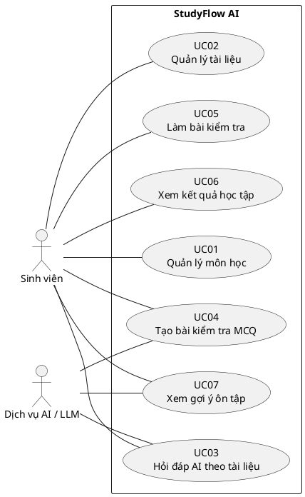

# Đặc tả Use Case — StudyFlow AI

## 1. Tác nhân và ranh giới
- **Sinh viên:** actor chính sử dụng ứng dụng Android.
- **Dịch vụ AI/LLM:** actor hệ thống bên ngoài, được backend gọi cho trả lời RAG, sinh câu hỏi và giải thích/gợi ý ngắn.
- **Backend StudyFlow:** thành phần nội bộ; nhận yêu cầu app, truy xuất dữ liệu/tài liệu, gọi LLM khi cần và trả dữ liệu có cấu trúc.

## 2. Sơ đồ Use Case tổng quát (PlantUML)

## UC01 — Quản lý môn học
**Actor:** Sinh viên.  
**Tiền điều kiện:** Ứng dụng mở được; kho dữ liệu sẵn sàng.  
**Kích hoạt:** Sinh viên mở tab Môn học hoặc chọn thao tác thêm môn.

**Luồng chính:**
1. Ứng dụng hiển thị danh sách môn học và trạng thái rỗng nếu chưa có môn.
2. Sinh viên chọn Thêm môn, nhập tên và mô tả tùy chọn.
3. Ứng dụng kiểm tra tên không rỗng, lưu môn và cập nhật danh sách.
4. Sinh viên chọn một môn để xem chi tiết và các tài liệu/quiz gắn với môn.
5. Khi sửa hoặc xóa, ứng dụng yêu cầu xác nhận xóa và cập nhật danh sách sau thao tác.

**Hậu điều kiện:** Môn học mới/sửa được lưu; môn bị xóa không còn trong danh sách. Dữ liệu phụ thuộc được xử lý theo chính sách được chốt trước khi triển khai.  
**Ngoại lệ:** Tên rỗng/trùng theo quy tắc ứng dụng → báo lỗi và giữ dữ liệu nhập; lưu thất bại → báo lỗi, giữ màn hình và cho thử lại; hủy xóa → không thay đổi dữ liệu.

## UC02 — Quản lý tài liệu
**Actor:** Sinh viên.  
**Tiền điều kiện:** Có môn học được chọn; backend/storage khả dụng nếu repo sử dụng backend.  
**Kích hoạt:** Sinh viên mở Tài liệu trong chi tiết môn và chọn thêm tệp.

**Luồng chính:**
1. Ứng dụng hiển thị tài liệu hiện có và thao tác tải lên.
2. Sinh viên chọn một PDF hoặc TXT.
3. Ứng dụng kiểm tra định dạng/kích thước theo giới hạn MVP và gửi tệp tới backend/storage.
4. Backend lưu tệp, trích xuất văn bản, chia thành đoạn có metadata môn học/tài liệu/trang (nếu có), rồi ghi trạng thái xử lý.
5. Ứng dụng hiển thị tài liệu cùng trạng thái sẵn sàng hoặc đang xử lý.
6. Sinh viên có thể mở thông tin hoặc xóa tài liệu sau xác nhận.

**Hậu điều kiện:** Tài liệu và nội dung trích xuất được gắn đúng môn, có thể được truy xuất cho UC03/UC04.  
**Ngoại lệ:** Định dạng không hỗ trợ/tệp lỗi → báo rõ và không tạo tài liệu; trích xuất thất bại → ghi trạng thái lỗi, cho thử lại/xóa; tải lên hoặc lưu thất bại → giữ thông tin để thử lại; tài liệu chưa xử lý xong → không giả vờ đã sẵn sàng cho RAG.

## UC03 — Hỏi đáp AI theo tài liệu
**Actor:** Sinh viên; Dịch vụ AI/LLM hỗ trợ.  
**Tiền điều kiện:** Có môn học hoặc tài liệu đã xử lý; backend và dịch vụ AI khả dụng.  
**Kích hoạt:** Sinh viên mở tab AI/chọn ngữ cảnh và gửi câu hỏi.

**Luồng chính:**
1. Ứng dụng hiển thị ngữ cảnh môn học/tài liệu đang chọn và lịch sử trao đổi tối thiểu.
2. Sinh viên nhập câu hỏi và gửi.
3. Backend tìm các đoạn liên quan trong phạm vi tài liệu đã chọn.
4. Backend gửi câu hỏi cùng các đoạn và metadata nguồn đến LLM với yêu cầu chỉ trả lời dựa trên ngữ cảnh.
5. Backend trả câu trả lời cùng danh sách trích dẫn (tên tài liệu, trang hoặc định danh đoạn).
6. Ứng dụng hiển thị câu trả lời và nguồn có thể nhận biết được.

**Hậu điều kiện:** Câu hỏi/câu trả lời có thể lưu trong lịch sử phiên demo; không thay đổi tài liệu gốc.  
**Ngoại lệ:** Không có đoạn phù hợp → trả lời rằng chưa tìm thấy căn cứ trong tài liệu và gợi ý chọn/tải tài liệu; LLM thiếu nguồn/định dạng sai → không hiển thị như câu trả lời đã được dẫn chứng; mạng/LLM lỗi hoặc hết thời gian → báo lỗi và cho thử lại; không có khóa API phía backend → ghi lỗi cấu hình an toàn, không để lộ secret.

## UC04 — Tạo bài kiểm tra MCQ
**Actor:** Sinh viên; Dịch vụ AI/LLM hỗ trợ sinh câu hỏi.  
**Tiền điều kiện:** Có tài liệu đã xử lý trong môn/chủ đề; dịch vụ AI khả dụng.  
**Kích hoạt:** Sinh viên chọn Tạo quiz.

**Luồng chính:**
1. Sinh viên chọn môn/chủ đề, số câu trong giới hạn MVP và tạo quiz.
2. Backend truy xuất nội dung liên quan; gọi LLM yêu cầu đầu ra MCQ có câu hỏi, các lựa chọn, một đáp án chuẩn, topic và giải thích ngắn.
3. Backend kiểm tra schema, số lựa chọn và khóa đáp án; gắn nguồn cho câu hỏi khi có thể.
4. Backend lưu quiz và trả về nội dung để bắt đầu UC05.

**Hậu điều kiện:** Quiz hợp lệ được lưu với đáp án chuẩn và topic; chưa ghi điểm trước khi nộp.  
**Ngoại lệ:** Không đủ nội dung → báo thiếu tài liệu phù hợp; LLM lỗi/đầu ra sai schema/không có đáp án duy nhất → loại đầu ra sai, thử sửa/ yêu cầu sinh lại có giới hạn hoặc báo lỗi; không tạo quiz rỗng hoặc chấm dựa trên diễn giải của LLM.

## UC05 — Làm bài kiểm tra
**Actor:** Sinh viên.  
**Tiền điều kiện:** Có quiz hợp lệ chưa nộp.  
**Kích hoạt:** Sinh viên bắt đầu quiz hoặc mở quiz đang làm.

**Luồng chính:**
1. Ứng dụng hiển thị câu hỏi, lựa chọn và tiến độ hiện tại.
2. Sinh viên chọn đáp án và di chuyển giữa các câu.
3. Ứng dụng giữ các lựa chọn trong phiên làm bài.
4. Sinh viên nộp bài; ứng dụng xác nhận nếu còn câu chưa trả lời.
5. Backend/app so đáp án với khóa đáp án cố định, tính số đúng và điểm theo công thức đã công bố, lưu kết quả theo topic.
6. Ứng dụng mở UC06.

**Hậu điều kiện:** Một kết quả không đổi được lưu; cùng câu trả lời và khóa đáp án luôn cho cùng điểm.  
**Ngoại lệ:** Nộp khi còn câu trống → cảnh báo và cho quay lại hoặc xác nhận nộp; mất kết nối trước khi lưu → giữ câu trả lời cục bộ và cho thử gửi lại nếu thiết kế hỗ trợ; quiz không hợp lệ/đã nộp → báo trạng thái, không chấm lần hai ngoài quy tắc đã định.

## UC06 — Xem kết quả học tập
**Actor:** Sinh viên.  
**Tiền điều kiện:** Có ít nhất một kết quả quiz đã lưu.  
**Kích hoạt:** Hoàn thành UC05 hoặc mở tab Tiến độ.

**Luồng chính:**
1. Ứng dụng tải kết quả gần nhất và tổng hợp đơn giản.
2. Hiển thị điểm, số câu đúng/sai, quiz/môn và thời điểm.
3. Hiển thị tỷ lệ đúng theo topic nếu câu hỏi có metadata topic.
4. Cho phép mở gợi ý ôn tập UC07.

**Hậu điều kiện:** Chỉ đọc dữ liệu kết quả; không thay đổi điểm đã lưu.  
**Ngoại lệ:** Chưa có kết quả → hiển thị trạng thái rỗng và nút tạo quiz; tải thất bại → báo lỗi và cho thử lại; thiếu topic → vẫn hiển thị điểm tổng, đánh dấu phân tích topic chưa đủ dữ liệu.

## UC07 — Xem gợi ý ôn tập
**Actor:** Sinh viên; Dịch vụ AI/LLM có thể hỗ trợ diễn đạt gợi ý.  
**Tiền điều kiện:** Có kết quả quiz với topic; nếu gợi ý dựa tài liệu thì tài liệu liên quan còn tồn tại.  
**Kích hoạt:** Sinh viên mở phần gợi ý từ kết quả/tab Tiến độ.

**Luồng chính:**
1. Hệ thống tổng hợp tỷ lệ đúng và số lần trả lời theo topic từ dữ liệu quiz.
2. Hệ thống xếp topic có tỷ lệ đúng thấp lên trước; chỉ đưa ra nhận định khi có đủ dữ liệu tối thiểu đã chọn cho MVP.
3. Ứng dụng hiển thị topic yếu và gợi ý xem lại tài liệu hoặc làm quiz khác.
4. Tùy chọn: backend dùng LLM để viết lời nhắc ngắn dựa trên topic/kết quả; logic chọn topic vẫn xác định từ điểm.

**Hậu điều kiện:** Không chỉnh sửa điểm; gợi ý liên kết được với dữ liệu đã ghi nhận.  
**Ngoại lệ:** Chưa đủ câu trả lời → nói rõ chưa đủ dữ liệu, không gán nhãn yếu; không có tài liệu liên quan → gợi ý chọn/tải tài liệu; LLM lỗi → vẫn hiển thị gợi ý quy tắc cơ bản; lỗi truy vấn kết quả → báo lỗi, cho thử lại.
